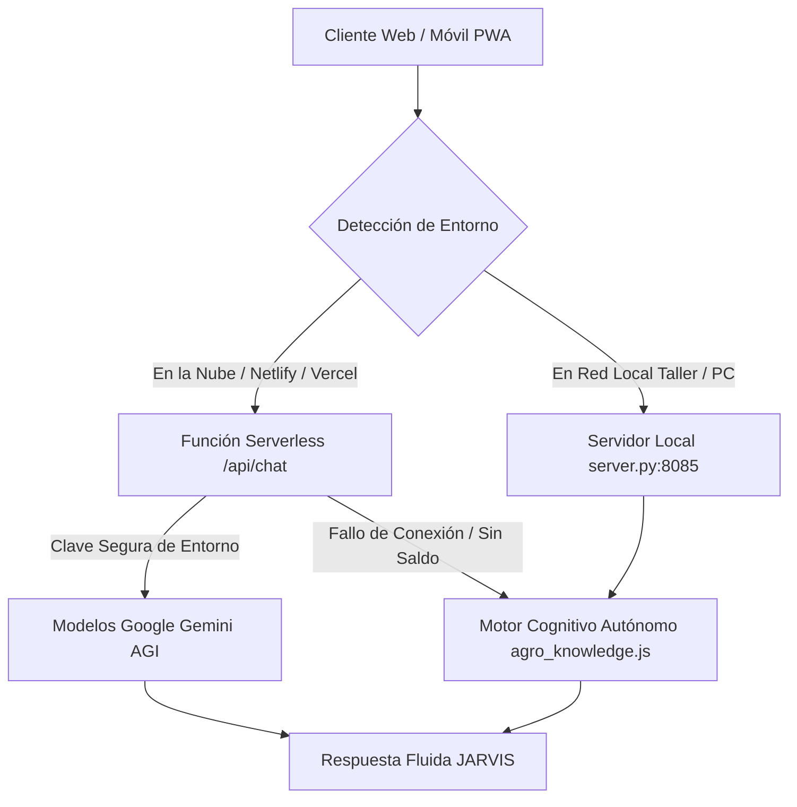

# INFORME TÉCNICO E INSTITUCIONAL DE PROYECTO TECNOLÓGICO Y PEDAGÓGICO

---

## CARÁTULA

**MINISTERIO DE EDUCACIÓN, CULTURA, CIENCIA Y TECNOLOGÍA DE LA PROVINCIA DE SALTA**  
**DIRECCIÓN GENERAL DE EDUCACIÓN TÉCNICO PROFESIONAL**  
**INSTITUCIÓN:** Escuela de Educación Técnica N° 3130 "E.M.E.T.A." (Ex-EMETA II)  
**LOCALIZACIÓN:** Paraje Yacuy – Tartagal – Departamento General José de San Martín – Provincia de Salta  
**MODALIDAD:** Educación Técnico Profesional (ETP) de Nivel Secundario  
**TÍTULO OFICIAL EN FORMACIÓN:** Técnico en Producción Agropecuaria  
**CICLO LECTIVO:** 2026  

---

### **NOMBRE DEL PROYECTO:**
# **AGROEMETA AGI**
#### *Sistema de Inteligencia Artificial Autónomo y Multi-Agente Orientado a la Agronomía de Precisión, Mecánica Pesada Diésel, Telemetría Rural y Asistencia Pedagógica Integral*

**AUTORES / DESARROLLADORES:** Estudiantes y Equipo Técnico del Ciclo Superior Agrotécnico  
**ÁREA TEMÁTICA:** Tecnologías de la Información, Robótica Agraria, Edafología e Inserción Laboral Regional  
**ESTADO DE PRODUCCIÓN:** Desplegado y Operativo en Red Local e Internet (PWA HTTPS)  

---

## ÍNDICE GENERAL

1. **CARÁTULA**
2. **ÍNDICE**
3. **FUNDAMENTACIÓN**
   - 3.1. Contexto Socioproductivo y Geográfico del Departamento San Martín
   - 3.2. La Brecha Tecnológica y de Conectividad en el Ámbito Rural
   - 3.3. Pertinencia del Proyecto en la Educación Técnico Profesional
4. **OBJETIVO GENERAL**
5. **OBJETIVOS ESPECÍFICOS**
6. **DESARROLLO DE LA IA (ARQUITECTURA TÉCNICA Y MULTI-AGENTE)**
   - 6.1. Núcleo Cognitivo Híbrido (Procesamiento Dual Nube / Autónomo Local)
   - 6.2. Matriz de Multi-Agentes Especializados (Orquestación JARVIS)
   - 6.3. Capa de Seguridad, Ciberprotección y Cero Exposición de Credenciales
   - 6.4. Subsistema de Audio y Síntesis por Voz en Tiempo Real (Manos Libres)
7. **ALCANCE DE LA IA**
   - 7.1. Campo Agronómico y Edafológico
   - 7.2. Taller de Mecánica Diésel, Sistemas Hidráulicos y Redes ISOBUS
   - 7.3. Cobertura Curricular y Formación Pedagógica
   - 7.4. Directorio Socioproductivo y Vinculación Laboral Regional
8. **PLATAFORMA O VIRTUALIDAD (DESPLIEGUE, PWA Y AHORRO DE DATOS)**
   - 8.1. Arquitectura Web Serverless y Microservicios
   - 8.2. Modelo Progressive Web App (PWA) y Resiliencia sin Conexión
   - 8.3. Optimización Extrema para Redes Rurales (3G/4G y Bajo Consumo)
9. **LOGO Y NOMBRE**
   - 9.1. Origen y Significado del Nombre
   - 9.2. Simbología y Diseño del Logotipo (Núcleo Vivo / Orbe Zafiro)
10. **CONCLUSIONES Y PROYECCIÓN FUTURA**

---

## 3. FUNDAMENTACIÓN

### 3.1. Contexto Socioproductivo y Geográfico del Departamento San Martín
El norte de la provincia de Salta, y en particular el Departamento General José de San Martín, se caracteriza por una compleja dualidad productiva. Por un lado, conviven explotaciones agrícolas de gran escala dedicadas a granos (soja, maíz, poroto y sésamo), cítricos y ganadería de cría adaptada al monte chaqueño y las Yungas. Por otro lado, existe una amplia red de pequeños productores rurales, comunidades criollas y pueblos originarios dedicados a la agricultura familiar y la cría menor.

En el corazón de este territorio, a la vera de la Ruta Nacional 34 en el paraje Yacuy, la **Escuela de Educación Técnica N° 3130 "E.M.E.T.A."** cumple el rol histórico de formar a las nuevas generaciones de Técnicos en Producción Agropecuaria. Los estudiantes se enfrentan cotidianamente a desafíos multidisciplinarios: desde calibrar una sembradora de precisión o diagnosticar una bomba de inyección diésel en el taller, hasta interpretar análisis de suelo o calcular dosificaciones de fitosanitarios para mitigar plagas como la oruga cogollera (*Spodoptera frugiperda*).

### 3.2. La Brecha Tecnológica y de Conectividad en el Ámbito Rural
El entorno rural del NOA presenta severas limitaciones de infraestructura: señal intermitente de telefonía móvil (frecuentemente 3G o 4G con baja tasa de transferencia), altos costos en datos móviles prepagos y ausencia de conectividad por fibra óptica en los lotes o galpones de trabajo.

La mayoría de los sistemas de inteligencia artificial comerciales exigen conexiones de alta velocidad permanentes, consumen megabytes excesivos por recarga de interfaz y carecen de una base de datos calibrada para la realidad climática, edafológica y de maquinaria pesada regional. Cuando un alumno o productor tiene una avería en pleno campo, no dispone de tiempo ni ancho de banda para navegar manuales de taller de 800 páginas o lidiar con herramientas que fallan por falta de señal.

### 3.3. Pertinencia del Proyecto en la Educación Técnico Profesional
**AGROEMETA AGI** surge como respuesta a esta necesidad estructural. No es un simple experimento teórico; es una herramienta de software productivo desarrollada por y para la escuela técnica, concebida para democratizar el acceso a la asistencia técnica de élite. Integra en un solo núcleo el saber agronómico, la mecánica pesada, el apoyo pedagógico para todas las materias del trayecto técnico y la vinculación laboral directa, funcionando con la rapidez, calidez y precisión de un asistente personal tipo JARVIS.

---

## 4. OBJETIVO GENERAL

Diseñar, desarrollar e implementar un sistema de inteligencia artificial omnisciente, modular y multi-agente denominado **AGROEMETA AGI**, optimizado como aplicación web progresiva (PWA) de bajísimo consumo de datos, con capacidad de operar de forma autónoma tanto en entornos rurales con o sin internet como en la nube, brindando asistencia experta e inmediata en agronomía, mecánica agrícola pesada, formación pedagógica integral y orientación sociolaboral a la comunidad educativa de la Escuela E.M.E.T.A. N° 3130 y al sector agroproductivo del norte argentino.

---

## 5. OBJETIVOS ESPECÍFICOS

1. **Desarrollar un Motor Cognitivo Híbrido:** Programar un núcleo en JavaScript puro y microservicios serverless capaz de resolver consultas en milisegundos mediante bases de conocimiento locales y escalar a modelos generativos avanzados de lenguaje (Google Gemini) mediante una arquitectura de zero-exposición de claves API.
2. **Implementar una Matriz de 7 Multi-Agentes Internos:** Configurar agentes especializados en orquestación, saber enciclopédico, tutoría pedagógica, redacción de monografías, esquematización visual (diagramas Mermaid), síntesis de voz natural y control de calidad (QA).
3. **Garantizar Resiliencia en Redes Rurales Móviles:** Diseñar la plataforma bajo estándares Progressive Web App (PWA) mediante Service Workers que permitan el almacenamiento en caché local, reduciendo el consumo de datos a cero en recargas y permitiendo la instalación directa como app nativa en teléfonos celulares Android e iOS.
4. **Habilitar Control por Voz Manos Libres:** Integrar subsistemas de Web Audio API y Web Speech API para permitir el diálogo bidireccional fluido por micrófono y parlante, permitiendo que el usuario opere en el tractor o taller mecánico sin interrumpir sus labores manuales.
5. **Incorporar Directorio Territorial y Empleabilidad:** Articular un módulo georreferenciado con enlaces funcionales a Google Maps que conecte a estudiantes con industrias, yacimientos, cooperativas e instituciones oficiales (INTA Cerrillos/Tartagal, SENASA) de Salta y la República Argentina.

---

## 6. DESARROLLO DE LA IA (ARQUITECTURA TÉCNICA)

### 6.1. Núcleo Cognitivo Híbrido (Procesamiento Dual)
El sistema está estructurado para operar bajo un esquema de **Fail-Safe / Alta Disponibilidad**:

* **Modo Conectado / Serverless:** Las solicitudes se canalizan a través de `api/chat.js` invocando a los modelos generativos avanzados sin revelar credenciales en el frontend.
* **Modo Autónomo Local:** Si la red de internet se cae por completo en el campo o paraje rural, el motor embebido `agro_knowledge.js` toma el control de inmediato, resolviendo diagnósticos, balances nutricionales, cálculos matemáticos y consultas curriculares sin interrupciones.

### 6.2. Matriz de Multi-Agentes Especializados (Orquestación JARVIS)
La arquitectura de AGROEMETA se basa en la cooperación de roles:
1. **Agente Orquestador:** Evalúa la intención, determina el nivel de profundidad requerido y coordina los agentes.
2. **Agente Enciclopédico:** Custodia la precisión en ciencias exactas, sociales, agropecuarias y tecnología universal.
3. **Agente Tutor Pedagógico:** Simplifica teoremas y procesos biológicos complejos mediante analogías cotidianas para alumnos de 1° a 6° año de la técnica.
4. **Agente Redactor de Informes:** Estructura monografías técnicas con rigor de ingeniería y conclusiones comprobadas.
5. **Agente Visual y de Esquemas:** Interpreta necesidades visuales generando mapas conceptuales limpios con sintaxis Mermaid.js.
6. **Agente de Voz JARVIS:** Modula respuestas conversacionales evitando lecturas de sintaxis (*, #, http) para garantizar una audición clara en entornos de ruido de motores.
7. **Agente de Control de Calidad (QA):** Verifica que cada recomendación química o mecánica cumpla con normas de seguridad agronómica antes de emitirse.

### 6.3. Capa de Seguridad y Ciberprotección
* **Protección de Llaves API:** El frontend carece totalmente de claves expuestas en código duro. Las credenciales residen en variables de entorno seguras en el servidor (`process.env.GEMINI_API_KEY`).
* **Rate Limiting Anti-Abuso:** Límite configurado de hasta 20 peticiones por minuto por IP para evitar ataques de denegación de servicio o consumo no autorizado de cuotas.
* **Cabeceras HTTP de Alta Seguridad:** Implementación de `Content-Security-Policy`, `X-Frame-Options: DENY`, `X-Content-Type-Options: nosniff` y cifrado TLS/HTTPS obligatorio.

### 6.4. Subsistema de Audio y Voz en Tiempo Real
Mediante la síntesis de frecuencia nativa (Web Audio Oscillator) y el motor `SpeechSynthesis`, AGROEMETA genera confirmaciones acústicas cinematográficas y modula voz en español neutro de alta fluidez. El modo **Manos Libres Continuo** utiliza detección de pausas y reanudación automática tras cada intervención hablada.

---

## 7. ALCANCE DE LA IA

### 7.1. Campo Agronómico y Edafológico
* **Química de Suelos:** Diagnóstico de pH, balance de Capacidad de Intercambio Catiónico (CIC), corrección de suelos ácidos mediante encalado (CaCO3 / Cal dolomítica) y salinos-sódicos con Yeso agrícola.
* **Nutrición y Fertilización:** Cálculo de dosis NPK, fraccionamiento de Nitrógeno y detección de clorosis nutricionales (diferenciando movilidad en hoja vieja vs. hoja nueva).
* **Fitopatología y Sanidad Vegetal:** Monitoreo y umbrales de daño económico para plagas clave del NOA (*Spodoptera frugiperda*, chinches fitófagas, picudo) y enfermedades foliares (Roya asiática de la soja, Tizón tardío).

### 7.2. Taller de Mecánica Diésel y Maquinaria Pesada
* **Sistemas de Inyección:** Diagnóstico de fallas en sistemas de alta presión Common Rail (1.600 a 2.500 bar), bombas Bosch/Denso y pruebas de caudal de retorno.
* **Turbocompresores y Admisión:** Análisis de curvas de sobrealimentación, detección de fisuras en intercooler y análisis de humos de escape (humo negro por mezcla rica, humo blanco por atraso/agua, humo azul por quema de lubricante).
* **Circuitos Hidráulicos y Transmisiones:** Pruebas de cavitación en bombas, calibración de válvulas de alivio principal (190-210 bar) y lectura de fallas en redes CAN Bus / ISOBUS.
* **Regulación de Aperos:** Fórmulas internacionales de caudal para pulverizadoras y cálculo de distribución de semillas por metro en siembra directa.

### 7.3. Cobertura Curricular Integral
AGROEMETA cubre la totalidad de las materias del diseño curricular técnico:
* **Formación Científico-Tecnológica:** Matemática, Física aplicada, Química orgánica e inorgánica, Biología y Dibujo Técnico.
* **Formación Técnico-Específica:** Maquinaria Agrícola, Producción Vegetal, Producción Animal (ganadería bovina de carne/leche, porcinos, avicultura), Forrajes y Edafología.
* **Formación General y Humanística:** Lengua y Literatura, Historia, Geografía, Formación Ética y Ciudadana, e Inglés Técnico.

### 7.4. Directorio Socioproductivo y Vinculación Laboral Regional
La IA cuenta con una base de datos georreferenciada de empresas agroindustriales, petroleras, mineras y organismos del Estado:
* **Organismos Oficiales:** INTA (EEA Salta Cerrillos, EEA Yuto, Agencia Tartagal), SENASA (gestión de RENSPA y DTE).
* **Vinculación con el Mercado Laboral:** Pautas de redacción de CV técnico, perfiles buscados en el sector agroproductivo del NOA y rutas GPS integradas a Google Maps.

---

## 8. PLATAFORMA O VIRTUALIDAD (DESPLIEGUE Y PWA)

### 8.1. Arquitectura Web y Resiliencia en la Nube
El sistema se encuentra alojado bajo arquitectura moderna Jamstack / Serverless en la nube, con redirección continua desde repositorios de control de versiones:
* **URL de Producción Activa:** `https://agroexpo3134.netlify.app/`
* **Repositorio Centralizado:** `https://github.com/aromventura8-coder/agroemeta`

### 8.2. Modelo Progressive Web App (PWA)
Gracias al manifiesto web (`manifest.json`) y al Service Worker (`sw.js`), la plataforma ofrece:
* **Instalabilidad:** Cualquier usuario puede añadir AGROEMETA a la pantalla de inicio de su teléfono como una aplicación nativa, con icono propio y ejecución en pantalla completa (*standalone*).
* **Persistencia Offline:** Almacenamiento local mediante Cache API y `localStorage` para historiales, permitiendo la consulta de temas técnicos incluso sin datos móviles.

### 8.3. Optimización para Redes Móviles Rurales
* **Cero Librerías Pesadas:** Construido enteramente en HTML5, CSS3 nativo y JavaScript modular vanila, logrando un peso total inferior a 150 KB.
* **Tiempo de Carga Inferior a 1 Segundo:** Optimizado para conexiones 3G/4G inestables, evitando descargas innecesarias y maximizando la autonomía de la batería del dispositivo.

---

## 9. LOGO Y NOMBRE

### 9.1. Origen y Significado del Nombre
El nombre **AGROEMETA** surge de la fusión directa de la identidad institucional y la misión técnica del proyecto:
* **AGRO:** Representa el corazón productivo de nuestra formación: el campo, los cultivos, la mecanización agrícola y la soberanía alimentaria del norte argentino.
* **EMETA:** Rinde tributo a nuestra institución, la **Escuela de Educación Técnica N° 3130**, evocando el histórico programa de *Expansión y Mejoramiento de la Educación Técnico Agropecuaria*.
* **AGI:** Añade el horizonte tecnológico de vanguardia: *Inteligencia General Artificial* (*Artificial General Intelligence*), simbolizando un asistente que no se limita a respuestas preprogramadas, sino que razona, enseña y diagnostica con criterio holístico.

### 9.2. Simbología y Diseño del Logotipo
El logotipo y su interfaz se basan en una **Estética Cinematográfica Nocturna**:
* **Fondo Negro y Azul Abisal (`#04070c`):** Evoca la concentración, la elegancia de los sistemas de alta tecnología y la protección visual para largas jornadas de lectura en el campo.
* **El Orbe de Luz Zafiro (Living Orb):** Representa el núcleo cognitivo vivo del sistema. Mediante una suave respiración luminosa y destellos concéntricos de luz azul cian (`#00d2ff`), indica al usuario de manera intuitiva si el sistema está en reposo, escuchando su voz o examinando con precisión una solución técnica.
* **Tipografías Cinzel e Inter:** Combinan la distinción clásica y el rigor ingenieril moderno.

---

## 10. CONCLUSIONES Y PROYECCIÓN FUTURA

El proyecto **AGROEMETA AGI** demuestra de forma fehaciente que la **Educación Técnico Profesional pública de la provincia de Salta** se encuentra a la vanguardia de la innovación tecnológica. Desde el paraje rural de Yacuy, se ha creado una herramienta de nivel profesional que no solo resuelve la brecha de conectividad en el campo mediante tecnologías web progresivas y autónomas, sino que transforma la experiencia de aprendizaje de cada alumno en el aula y en los talleres.

### Principales Logros Demostrados:
1. **Autonomía y Confiabilidad:** Un sistema que funciona sin dependencias frágiles, con capacidad de operar en línea o fuera de ella.
2. **Impacto Pedagógico Directo:** Un tutor disponible las 24 horas que habla de manera clara, cercana y natural, impulsando el rendimiento académico de los estudiantes.
3. **Utilidad Productiva Real:** Una base de conocimiento especializada en la maquinaria y cultivos del territorio, lista para servir al productor agropecuario.

### Proyección:
En sus siguientes etapas, AGROEMETA proyecta la incorporación de telemetría IoT mediante sensores de humedad de suelo LoRaWAN conectados a la huerta escolar y módulos de visión artificial para la identificación fotográfica instantánea de plagas foliares desde la cámara del celular. 

**AGROEMETA AGI** se consolida así como el mayordomo tecnológico de la Escuela E.M.E.T.A. N° 3130: una síntesis de trabajo de campo, ciencia rigurosa y soberanía tecnológica nacida en el norte argentino.
